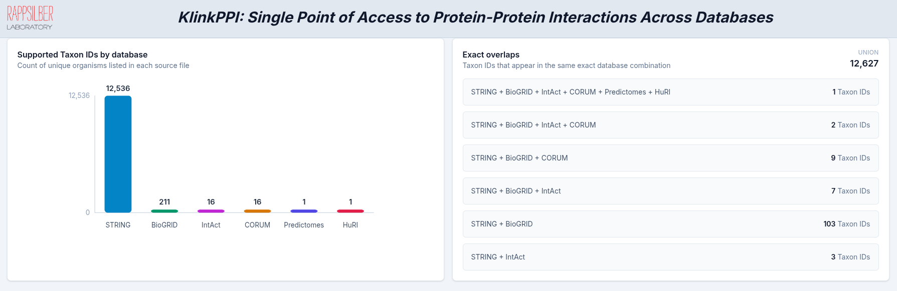

# KlinkPPI

KlinkPPI is a web application for exploring protein-protein interaction (PPI) data across multiple sources from one interface. It combines results from `STRING`, `CORUM`, `IntAct`, `BioGRID`, `HuRI`, `Predictomes`, `Complex Portal`, `Reactome`, `SIGNOR`, `HIPPIE`, `hu.MAP 3.0`, and `MINT`, then lets users inspect and download the results in a `PSI-MI TAB 2.8`-compatible tab-delimited format or `Parquet`.

## Features

- Search by `UniProtKB`, `GeneID`, `Ensembl`, or `Gene Name`
- Filter queries by taxonomy ID
- Query one database or several at once
- Review results in separate sections by database
- Download selected results as `MI TAB`-compatible tab-delimited files or `Parquet`

## Examples

### Intro



### Search


### Results


## Project Structure

- `backend/`: FastAPI backend
- `frontend/`: React + Vite frontend
- `Data/`: local database files used by several backend resolvers
- `../Supported_Organisms/`: taxonomy support tables for each source

## Prerequisites

- `Python 3.12+` required for all embedding models
- `Node.js 20.19+` or `22.12+`
- `npm`

`Node.js 18` is not sufficient for the current Vite version in this repository. For installing the new one: 

```bash
# 1. Download and run the install script
curl -o- https://raw.githubusercontent.com/nvm-sh/nvm/v0.40.5/install.sh | bash

# 2. Load NVM into your current terminal session
# (Try bashrc first; if you use zsh, replace with ~/.zshrc)
export NVM_DIR="$HOME/.nvm"
[ -s "$NVM_DIR/nvm.sh" ] && \. "$NVM_DIR/nvm.sh"

# 3. Verify installation
nvm --version
nvm install 20
nvm use 20
   
```

## Installation

Clone the repository and work from the project root:

```bash
git clone <your-repo-url>
cd KlinkPPI
```

Clone the PLM framework separately into the KlinkPPI project root before installing
dependencies (skip this command if `embedding_FW/` is already present):

```bash
git clone https://github.com/lutfia95/embedding_FW.git embedding_FW
```

The folder must be named `embedding_FW` and sit beside `backend/` and `frontend/`.

Install the backend and frontend dependencies from the project root:

```bash
npm install
```

This creates `.venv/`, installs `requirements.txt`, and installs the frontend npm packages.

## Running the Application

Start both the FastAPI backend and Vite frontend from one terminal:

```bash
npm run dev
```

Then open:

```text
http://localhost:5174
```

### Extended database data

Complex Portal species files are cached automatically on first use. Reactome and MINT are queried through their PSICQUIC services; SIGNOR and HIPPIE use their public query APIs.

The hu.MAP 3.0 interaction network is a large bulk download and is deliberately not downloaded by a web request. Install or refresh its local SQLite lookup index explicitly:

```bash
.venv/bin/python scripts/update_extended_databases.py --source humap
```

Until that command finishes, hu.MAP remains selectable and reports that its local index is not installed. Every source, including each extended source, has an `AllSpecies*.csv` file under `Supported_Organisms/` and therefore participates in the organism coverage and overlap overview.

Complete-species jobs are implemented for Complex Portal and hu.MAP 3.0. Reactome, SIGNOR, HIPPIE, and MINT currently support single-protein searches and exports; their complete-species bulk ingestion remains intentionally disabled until version-pinned bulk refresh jobs are added.

Run the extended-source regression tests with:

```bash
PYTHONPATH=backend .venv/bin/python -m unittest discover -s tests -v
```

The default frontend port is `5174`. If that port is already in use, pass a different port from the project root:

```bash
npm run dev -- --port 5175
```

If the app needs to be reachable from another machine on the network, also expose the Vite host:

```bash
npm run dev -- --host 0.0.0.0 --port 5175
```

To run only the frontend from the project root, use npm's `--prefix` option:

```bash
npm --prefix frontend run dev -- --port 5175
```

## Notes

- The frontend is configured to connect with to the backend at `http://127.0.0.1:8000`. To change the backend port modify scripts/dev.mjs function main '--port', '8000' to '--port', 'xyz' and function waitForBackend const healthUrl = 'http://127.0.0.1:xyz/health'; where xyz is the new port (e.g. 8080)
- to accept connections from anything but localhost the frontend need to listen to 0.0.0.0 (scripts/dev.mjs function main change '--hist', '127.0.0.1', ...frontendArgs to '--hist', '0.0.0.0', ...frontendArgs) and the host names under which the script should be reachable needs to be registered (vite.config.js add allowedHosts: ["hostname1", "hostname2"] to plugins.server

- The backend CORS configuration allows `localhost` and `127.0.0.1` development origins on any port.
- Several backend resolvers call external services such as UniProt, Ensembl, STRING, and IntAct, so an internet connection is required for full functionality.
- If `npm run dev` or `npm run build` fails after switching Node versions, remove stale dependencies and reinstall with `npm install`.
- MITAB exports use shared core columns for all selected databases. The `Source database(s)` field uses verified PSI-MI source terms where available: `psi-mi:"MI:1014"(string)`, `psi-mi:"MI:0463"(biogrid)`, and `psi-mi:"MI:0469"(intact)`. Sources without verified PSI-MI database terms are exported as `corum`, `huri`, and `predictomes`.
- In case HuRI is used from the source, then run the preprocessing for ID mapping:  
  `python KlinkPPI/scripts/preprocess_huri_uniprot.py`

## Download Columns

The columns below assume all databases and all optional evidence fields are selected. Parquet exports use the union of database-specific fields; fields that do not apply to a row are empty or `-`.

### Single-Protein MITAB-Compatible Export

Single-protein MITAB-compatible downloads always use the same shared columns:

| Column |
| --- |
| `#ID(s) interactor A` |
| `ID(s) interactor B` |
| `Taxid interactor A` |
| `Taxid interactor B` |
| `Interaction detection method(s)` |
| `Interaction type(s)` |
| `Publication Identifier(s)` |
| `Source database(s)` |
| `Confidence value(s)` |

Database-specific values are encoded inside these shared columns. For example, STRING scores are written as `string-combined-score:<value>`, BioGRID confidence as `biogrid-confidence-score:<value>`, IntAct scores as `intact-miscore:<value>`, CORUM metadata as `corum-complex-name:<value>`, and Predictomes scores as `predictomes-spoc-score:<value>`.

### Single-Protein Parquet Export

Single-protein Parquet exports include these fields when all databases are selected:

| Database | Columns |
| --- | --- |
| BioGRID | `Database`, `Interactor_A`, `Interactor_B`, `organism`, `Interaction_Detection_Method`, `Interaction_Type`, `Confidence_Score` |
| CORUM | `Database`, `complex_name`, `cell_line`, `Purification_Method`, `Interactor_A`, `Interactor_B`, `Organism` |
| Predictomes | `Database`, `Interactor_A`, `Interactor_B`, `spoc_score`, `kirc_score`, `num_unique_contacts` |
| STRING | `Database`, `Interactor_A`, `Interactor_B`, `Organism`, `combined_score`, `gene_neighbourhood_score`, `gene_fusion_score`, `phylogenetic_profile_score`, `experimental_score`, `coexpression_score`, `textmining_score`, `database_score` |
| IntAct | `Database`, `Interactor_A`, `Interactor_B`, `Num_Interaction_IntAct`, `Minimum_feature_count`, `Maximum_feature_count`, `Interaction_Score_Intact`, `Unique_Identification_Methods`, `PubMed_Ids` |
| HuRI | `Database`, `Interactor_A`, `Interactor_B`, `Interactor_A_UniProt`, `Interactor_B_UniProt`, `Interactor_A_Ensembl`, `Interactor_B_Ensembl` |

### Complete-Species MITAB-Compatible Export

Complete-species MITAB-compatible downloads use the same shared columns as single-protein MITAB-compatible downloads:

| Column |
| --- |
| `#ID(s) interactor A` |
| `ID(s) interactor B` |
| `Taxid interactor A` |
| `Taxid interactor B` |
| `Interaction detection method(s)` |
| `Interaction type(s)` |
| `Publication Identifier(s)` |
| `Source database(s)` |
| `Confidence value(s)` |

The `Source database(s)` values follow the same rule as single-protein MITAB exports: verified PSI-MI source terms are used for STRING, BioGRID and IntAct; CORUM, HuRI and Predictomes are written as source names.

### Complete-Species Parquet Export

Complete-species Parquet exports include these fields when all databases are selected:

| Database | Columns |
| --- | --- |
| STRING | `Database`, `String_Id_A`, `String_Id_B`, `Interactor_A`, `Interactor_B`, `Interactor_A_Prefix`, `Interactor_B_Prefix`, `Interactor_Gene_Name_A`, `Interactor_Gene_Name_B`, `preferred_name_A`, `preferred_name_B`, `annotation_A`, `annotation_B`, `combined_score`, `gene_neighbourhood_score`, `gene_fusion_score`, `phylogenetic_profile_score`, `experimental_score`, `coexpression_score`, `textmining_score`, `database_score` |
| IntAct | `Database`, `Interactor_A`, `Interactor_B`, `Interactor_A_Prefix`, `Interactor_B_Prefix`, `Interactor_Gene_Name_A`, `Interactor_Gene_Name_B`, `Taxid_A`, `Taxid_B`, `Unique_Identification_Methods`, `PubMed_Ids`, `Interaction_Score_Intact`, `Num_Interaction_IntAct`, `Minimum_feature_count`, `Maximum_feature_count`, `Interaction_Type`, `Source_Database`, `Publication_Identifiers_Raw` |
| BioGRID | `Database`, `Interactor_A`, `Interactor_B`, `Interactor_Gene_Name_A`, `Interactor_Gene_Name_B`, `organism`, `Interaction_Detection_Method`, `Interaction_Type`, `Confidence_Score` |
| CORUM | `Database`, `Interactor_A`, `Interactor_B`, `Interactor_Gene_Name_A`, `Interactor_Gene_Name_B`, `Organism`, `complex_name`, `cell_line`, `Purification_Method` |
| Predictomes | `Database`, `Interactor_A`, `Interactor_B`, `Interactor_Gene_Name_A`, `Interactor_Gene_Name_B`, `spoc_score`, `kirc_score`, `num_unique_contacts` |
| HuRI | `Database`, `Interactor_A`, `Interactor_B`, `Interactor_A_UniProt`, `Interactor_B_UniProt`, `Interactor_A_Ensembl`, `Interactor_B_Ensembl` |

## API Endpoints

- `GET /search`
- `POST /mitab`
- `POST /parquet`

## Collection searches

Open **Collection search** beside **Single searches**. Choose a supported species from
its suggestions, paste a list or upload a CSV/TSV/TXT file, and select the source
databases and network mode. Files contain one identifier per line, without a header
or extra columns. Collections support up to 20 distinct identifiers; duplicate rows
are merged. Mixed lists detect UniProt accessions/entry names, gene symbols, Ensembl
IDs and NCBI GeneIDs. Select an explicit identifier type for gene symbols that resemble
another ID format. UniProt isoforms resolve to their primary accession, so analysis
runs at the protein-entry level.

The input is labeled **Gene / protein list (up to 20 entries)**. The 20 distinct
identifier limit applies to pasted lists, uploaded CSV/TSV/TXT files, and
`POST /collection/jobs` API requests after trimming and duplicate merging.
Over-limit requests return a clear error before a job starts.

Each protein in **Pairs with no interaction found** offers **Search BLASTP ↗**,
**Copy FASTA**, and **Find similar structures ↗**. Sequences are fetched on demand
via `GET /collection/jobs/{job_id}/sequence?accession=P04637`, restricted to resolved
collection inputs, and checked against the exact UniProt accession and collection
taxonomy. Successful sequences are reused across repeated proteins; failed lookups
can be retried. FASTA headers contain the accession and collection gene name.
Clipboard failures display selectable FASTA text.

BLAST opens the [NCBI Protein BLAST form](https://blast.ncbi.nlm.nih.gov/Blast.cgi?PAGE=Proteins)
using a form POST with the FASTA and a descriptive job title. Users choose settings
and start the search themselves. If the browser blocks the tab, allow popups and
retry, or copy FASTA into Protein BLAST. No alignment length limit applies to FASTA
copying or BLAST prefill.

Find similar structures opens the protein's AlphaFold entry. Choose **Similar
structures** there to search with Foldseek. If no AlphaFold model is available,
use **Copy FASTA** and paste it into the [Foldseek server](https://search.foldseek.com/).

**Resolve collection IDs** validates identifiers against the selected species using
UniProt. Review the candidate table before running: ambiguous IDs require an explicit
candidate or **Skip this ID**. Unresolved and skipped inputs appear as isolated amber
nodes, with no fabricated interactions. Multiple inputs mapping to one accession
produce one protein node, while the report retains counts for the original input IDs.

- **Induced** includes only interactions between resolved input proteins.
- **Expanded** adds direct first-neighbor connections from the inputs. Neighbor edges
  are gray. Neighbor-to-neighbor edges and additional hops are not queried or inferred.

Induced results include **Pairs with no interaction found**, a searchable, paginated
list of resolved input pairs without evidence in the full search results (before
display filters). Click **Check GO** to fetch both proteins' UniProt annotations and
show exact shared GO IDs, names, categories and annotation evidence for each protein.
Annotations are fetched on demand and cached per protein for up to an hour. Ancestor
terms are not inferred. Shared GO terms do not establish a protein interaction;
missing interaction evidence can reflect incomplete database coverage.

The API exposes this comparison through
`GET /collection/jobs/{job_id}/shared-go?source=P04637&target=P38398` for a completed
induced job. Both accessions must be resolved inputs without an existing edge in
that job. UniProt failures return a retryable error rather than an empty comparison.

The **Alignment** column has an **Align seqs** button for each unknown pair. On click,
the backend fetches full UniProt protein-entry sequences, checks species and accessions,
and computes a global pairwise alignment. A progress bar reports three completed stages:
first sequence, second sequence, alignment. The result includes raw score, percent identity
(identical residues / all alignment columns, including gaps), and an expandable alignment
panel spanning the full width beneath the pair. Residues are colored by amino-acid
property with a legend; identity/substitution markers and original residue positions
help read the alignment. Long alignments scroll within the panel.
Failures show a retry action rather than a zero score.

Alignment uses Biopython 1.88 `PairwiseAligner` with Gotoh global alignment
(Needleman–Wunsch with affine gaps), BLOSUM62, gap open penalty 10 and extension
penalty 0.5. A gap of length L costs `10 + (L - 1) * 0.5`; terminal gaps use the
same penalties. U/O residues are scored as X while their original letters are retained
in the output. B/Z/X use BLOSUM62 scores. The method and parameters appear below the
pair list and in each expanded result. Sequence similarity does not establish an interaction.
Sequences are cached for up to one hour. Alignments run with two workers, at most 64
retained tasks, a 20,000-residue limit per sequence and 25 million sequence-position
pairs per alignment. Larger pairs fail explicitly rather than returning partial scores.

Use `POST /collection/jobs/{job_id}/alignments` with `source` and `target` accessions,
then poll `GET /collection/jobs/{job_id}/alignments/{alignment_id}` for stage progress
and results. The same unknown-pair restrictions as the GO comparison apply.

The custom Canvas network supports dragging, zooming, searching by gene/accession,
community separation, node details and click-based evidence inspection. Filter source databases, evidence category,
reported publication count, experimental method and raw source scores. Publication
counts use distinct IDs; unavailable metadata remain unknown. Score thresholds affect
only evidence from the chosen database; independent retained evidence may keep a pair
visible. Complex co-membership and STRING associations are functional evidence, not
proof of direct binding. Directed source evidence retains its regulator, target and
effect even though topology statistics use an undirected simple graph.

The appearance menu controls labels, source colors and edge widths. Consensus widths
use the number of source databases, not the number of independent experiments.
Integrated sources can overlap; source warnings are included in the report. Relative
score widths scale each source/score series within its visible range and average the
result as a visual cue. Raw scores are not compared as probabilities.

Click **Open full window** beside the network to open a full-screen image studio
using the current filtered network and layout. Adjust the background, font color,
node size, labels and edge appearance, then download PNG (current view) or SVG
(whole network). Appearance changes also apply to the results page. Close the
window with its close button or Escape.

Statistics update for the filtered graph in a background worker: node/edge counts,
unique/shared database pairs, Jaccard overlaps, degrees/hubs, connected components,
mean local clustering, score histograms and shared/database-only interactors.
Clustering includes isolated nodes as zero; Jaccard is N/A for an empty union.
Download the current network as SVG, PNG, GraphML, SIF, Cytoscape CX or JSON, or download
an analysis PDF with the network, settings, mapping report, coverage notes and statistics.
JSON retains evidence and analysis metadata; SIF records topology only.

Collection jobs run in the background with bounded concurrency and cancellation.
Up to 12 jobs are retained per server process; inactive jobs expire after one hour.
Restarting the backend clears them, so use one backend worker for the current local
job store. Networks are capped at 50,000 pairs, 200,000 retained evidence rows and
10,000 additional identifiers for validation. Source failures, ambiguous/unmapped
interactors and truncated results are reported explicitly. Large networks use a
circle layout and paginated degree tables to reduce browser work.

Collection CORUM queries include every matching complex with publications and methods.
BioGRID index schema 4 retains PubMed identifiers; the first lookup after upgrading
rebuilds the existing local index from its MITAB source. On the full dataset, this
one-time rebuild can take several minutes.

Run the collection regression checks from the repository root:

```bash
PYTHONDONTWRITEBYTECODE=1 PYTHONPATH=backend .venv/bin/python -m unittest discover -s backend/tests -v
npm --prefix frontend test
npm --prefix frontend run build
```

The evidence tests require the configured local CORUM data and backend dependencies.
The frontend requires Node 20.19+ (or a supported newer Node release).

## Python API client

`klinkppi.py` provides the web application's single-protein, supported-species,
complete-species and collection workflows without plotting dependencies. It polls
background jobs, returns ordinary dictionaries, downloads species MITAB/Parquet,
and exports single-search or collection results to JSON/CSV.

```python
from klinkppi import KlinkPPIClient

client = KlinkPPIClient("http://127.0.0.1:8000")
result = client.single_search("Q07889", tax_id="9606", databases=["String", "IntAct"])
client.export_single_csv(result, "sos1_interactions.csv")
```

Start with `python python_api_example.py --help` or the equivalent `api_example.py`.
Choose `species`, `gene`, `single`, `complete-species`, `collection` or `followups`;
importing the examples performs no requests. See [the API examples guide](api_examples/README.md)
for the web/API feature matrix, mapping review and resume, cancellation, source-aware
filters/statistics, FASTA/BLAST/Foldseek, GO/alignment, and all data export formats.
`GET /collection/jobs/{job_id}/analysis` exposes the web network filters and
statistics for completed collections. Browser-rendered SVG/PNG and analysis PDF
remain available through the web app.

## Embedding comparisons for unknown collection pairs

In an induced collection search, the unknown-pairs table includes an **Embedding**
column beside Alignment. Click the model selector in its header to open a compact
popup, select exactly one model, and click **Done**. The selector shows the selected
model name. Then click **Compute distances** for a pair. Expand the resulting scores
to see each value and its explanation. Click **Download PLM scores (TSV)** in the
expanded panel to save all computed scores with the columns `metric` and `value`.
The filename uses the pair names, for example `TP53_BRCA1_plm_scores.tsv`. Results retain the models used even if the selection changes;
click again to compute the new selection. Progress, total runtime and per-model runtime
are shown. Runtime includes sequence retrieval, model loading/downloads and scoring,
but excludes time waiting for the worker.

All 12 models in `embedding_FW/examples/test_two_seqs_mem.py` are supported by both
the KlinkPPI interface and API:

- ESM-2: `esm2-8m`, `esm2-35m`, `esm2-150m`, `esm2-650m`.
- ESM-1b: `esm1b-650m`.
- ESM-1v: `esm1v-650m-1`, `esm1v-650m-2`, `esm1v-650m-3`, `esm1v-650m-4`, `esm1v-650m-5`.
- ESM-C: `esmc-300m`, `esmc-600m`.

KlinkPPI deliberately exposes this example's model set; other models in the framework
registry are not enabled in this integration. KlinkPPI uses the framework’s public embedding API and metrics to match
the two-sequence example. It returns five sequence baselines and fourteen embedding scores per selected model
(mean/max pooling with five vector metrics each, plus four residue metrics).
Mean, max and residue embeddings use L2 normalization. The API returns a sentence
explaining every score. These similarities are not interaction probabilities or
experimental interaction evidence; values from different models need not be calibrated.

Clone [embedding_FW](https://github.com/lutfia95/embedding_FW.git) separately into
`embedding_FW/` in the project root using the installation command above. Use Python **3.12+**, required by the bundled
ESM-C backend. `npm install`, `npm run setup`, and the root `npm run build` install the
local framework package and both Hugging Face and Biohub ESM-C dependencies through
`requirements.txt`. Root `npm run build` also builds the frontend. A frontend-only
build (`npm --prefix frontend run build`) assumes backend setup has already run.
To choose Python explicitly, run `PYTHON=python3.12 npm run setup`. An existing older
`.venv` must be recreated with Python 3.12+ first. The model dependencies include
PyTorch and can require substantial disk space. Model weights download on first use
and use the upstream Hugging Face cache; set `HF_HOME` to choose a writable persistent
cache directory. Weight downloads require internet access. CPU or CUDA is selected
automatically; available memory and checkpoint access still determine whether a model
can run on a given machine.

Only full validated UniProt sequences for unknown resolved input pairs in completed
induced collections are accepted. ESM-2/ESM-1b/ESM-1v allow at most 1,022 residues per
sequence; ESM-C allows 2,046. Longer inputs fail explicitly without truncation. One
embedding task runs at a time per backend process, and selected models run sequentially.
Tasks are kept in memory for up to an hour, with a maximum of 32 retained tasks per
process; use one backend worker or sticky routing, as for other collection jobs.
Model failures return an error without publishing partial scores.

API endpoints (also described in `/docs`):

- `GET /collection/embedding-models`: supported IDs and metric explanations.
- `POST /collection/jobs/{job_id}/embeddings`: JSON `source`, `target`, `models`
  (nonempty list; defaults to `["esm2-8m"]`); returns HTTP 202 and an `embedding_id`.
- `GET /collection/jobs/{job_id}/embeddings/{embedding_id}`: status, progress,
  completed/total steps, runtime, error, and completed `result`. The result contains
  `scores`, `descriptions`, `model_runtime_seconds`, and sequence lengths.

For example, using the public Python client and an existing completed collection:

```python
from klinkppi import KlinkPPIClient

client = KlinkPPIClient("http://127.0.0.1:8000")
print(client.embedding_models())
task = client.embed_pair(
    job_id, source_accession, target_accession,
    models=["esm2-8m", "esmc-300m"],
    on_progress=lambda progress: print(progress["progress"]),
)
print(task["runtime_seconds"])
for score, value in task["result"]["scores"].items():
    print(score, value, task["result"]["descriptions"][score])
```

`start_embedding` and `get_embedding` support asynchronous API clients. Invalid models
or ineligible pairs return HTTP 400; missing/expired jobs or tasks return 404; task
capacity returns 429. Model and sequence-fetch failures appear as `status: "failed"`
with an explanatory `error` in the polled task.
